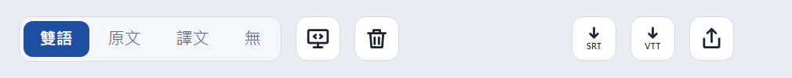
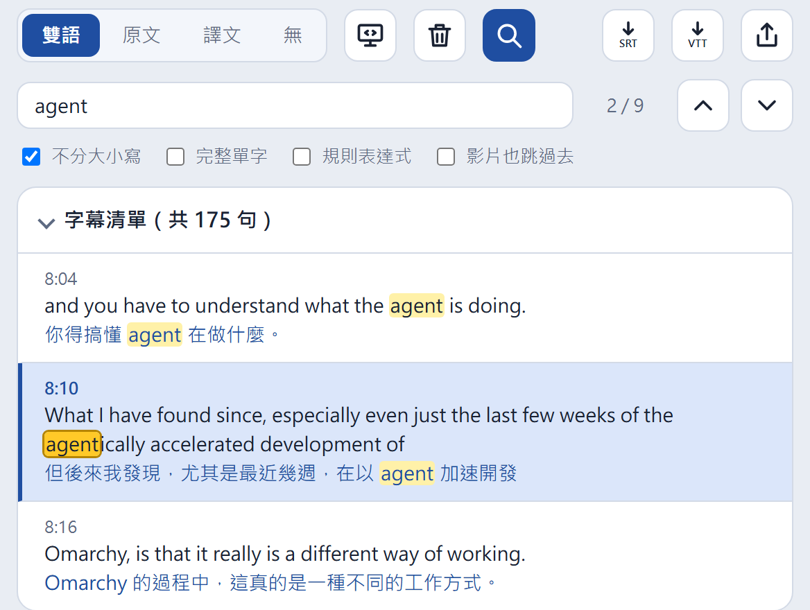
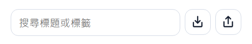

**English** | [繁體中文](https://github.com/codemee/tubetran/blob/main/README.md)

# TubeTran (水管譯工)

Paste a YouTube URL to play the video with bilingual subtitles (original + Traditional Chinese).
One program, two ways to run it: a **desktop app** (just run it) or a **server** (add `--server`).

## Features

- Downloads YouTube captions first (manual captions in the video's own language preferred, then auto-generated; captions in other languages are ignored); when there are none, downloads the audio and transcribes it locally with Whisper.
- Translates to Traditional Chinese (Taiwan usage) with the Claude API, including the video title. Subtitles are shown one sentence at a time: auto-caption fragments that break mid-sentence are first regrouped into whole sentences before translation, so translations never drift out of alignment, and terms (such as namespace or cgroup) are translated consistently across the whole video.
- Subtitles are overlaid on the video and stay visible in fullscreen; long subtitles are wrapped into two lines of similar length, breaking after punctuation where possible. Switch between bilingual / original / translation / none (no subtitles, for listening practice), and download SRT / VTT. YouTube's own captions are always hidden and replaced by ours.
- The toolbar below the player (icon buttons; hover to see their names):

  

  | Icon | What it does |
  |---|---|
  | 雙語 / 原文 / 譯文 / 無 (bilingual / original / translation / none) | Subtitle mode; "none" shows no subtitles, for listening practice |
  | Presentation board | Slide mode (see the next item); the icon turns to the accent colour while on |
  | Trash can | Delete this video's slide images (saves space); shown only when there are captured images |
  | Magnifier | Search subtitles (see "Search subtitles" below); the icon turns to the accent colour while open |
  | Download SRT / VTT | Download the subtitle file (following the current subtitle mode; "none" downloads bilingual) |
  | Export arrow | Export this video to import on another computer (shown once translated) |
- Slide mode (the presentation-board icon in the toolbar): the video stays on one subtitle's moment, and you step through subtitles with the ‹ › buttons on either side of the player (or ← →, PageUp / PageDown, so presentation clickers work too); the top left shows "current / total", and audio is muted while stepping. Press the button again to leave, staying where you were.
  - The pictures are captured by TubeTran itself, without YouTube's play button, title bar and other overlays: the first time you enter slide mode for a video, it downloads the video in the background (picture only, 1080p preferred), captures one image just before each subtitle ends (avoiding transitions at the start of a sentence, so the picture is complete), then deletes the video. Progress is shown at the top right; a 10-minute video takes about 30–40 seconds and about 20 MB of images.
  - Images are captured in subtitle order and shown as soon as they are ready; the ones not ready yet still show YouTube's overlays for a moment. Next time slide mode uses them directly, and switching is instant.
  - Reprocessing a video (the sentences change) captures them again; exports do not include these images, so another computer captures them the first time it enters slide mode.
  - When you no longer need them, press the trash-can icon in the toolbar (the confirmation shows how much space they use); slide mode captures them again next time.
- The subtitle list (below the player, expandable) follows playback: the line being played is highlighted and scrolled to the middle, and clicking any line jumps there. Scrolling through the list yourself pauses following; press "Back to current line" at the bottom right to return to the line being played.
- Search subtitles (the magnifier in the toolbar): find words in the subtitle list; matches are highlighted (the current one darker, with an outline) and the list scrolls to that line.

  

  | Action | What it does |
  |---|---|
  | Type a word | Searches when you stop typing and goes to the first match after the current playback position (only the list scrolls; the video stays); "match / total" is shown on the right |
  | ⌃ ⌄ or Shift+Enter / Enter | Previous / next match, wrapping around |
  | 不分大小寫 (Ignore case) | On by default |
  | 完整單字 (Whole word) | Match whole English words only (`cat` won't find `catalog`); Chinese has no spaces between words, so it is not affected |
  | 規則表達式 (Regular expression) | Search with a regular expression (e.g. `v\d+`); the box turns red if it is invalid |
  | 影片也跳過去 (Jump the video too) | When on, previous / next also jumps the video to that line (in slide mode, to that slide); when off, only the list scrolls, and "Back to current line" takes you back |
  | Esc / press the magnifier again | Close the search and clear the highlights |

  - Only the text shown in the list is searched: bilingual mode searches both the original and the translation; original or translation mode searches only that one.
  - The options are remembered on this computer; the search text is kept when you switch videos.
- Fullscreen: use the fullscreen button at the player's bottom right (next to the YouTube wordmark), or press `F`. After you press the fullscreen button, focus returns to the player, so ← → seek right away (in slide mode they go to the previous / next line). In the desktop app `F` also works after you have clicked the video (in browser mode, click outside the video first so the page can receive `F`). The fullscreen button shows and hides together with YouTube's own controls: the desktop app detects whether the "YouTube" wordmark at the bottom right of the control bar is visible; a browser cannot, so there the button stays visible while the pointer is over the player.
- Translated lines are usable while translation is still running; the rest continues in the background, with a clear progress bar. For videos without captions, the stages of speech recognition are listed under the progress bar (download audio, download the speech model [first time only], load the model, decode audio and detect language, transcribe), with completed stages ticked and the current one showing its percentage.
- A library on the right lists translated, in-progress, interrupted and failed videos; click to watch again (click an interrupted or failed video, or press ↻ on it, to retry from where it stopped), delete the cache if you like (pressing ✕ on a video that is still processing cancels it and cleans up). The last playback position is remembered so you can pick up where you left off. Each item, and the title under the player, has an "Open on YouTube" link for comments and related videos (the desktop app opens it in your default browser).
- Search and tags in the library: search titles (original and translated) and tags; add tags to any video (the "+ Tag" button on the item, press Enter to add), then click tags in the bar above the list to filter. Multiple tags can be selected (a video must have all of them), and filtering combines with search. The bar always starts with "Untagged", which lists only the videos that have no tags yet (it is mutually exclusive with the regular tags); with many tags the bar shows a single row, and "More +N" at its end expands the rest, while "Clear filters" stays fixed on the right.
- Buttons on each library item (shown when you hover over it):

  | Button | What it does |
  |---|---|
  | ↗ Open on YouTube | Go back to YouTube for comments and related videos |
  | ↻ Reprocess | Discard the current translation, fetch captions again and retranslate sentence by sentence (calls Claude again); watch progress and tags are kept. Use it to convert videos translated by older versions to one sentence per subtitle |
  | ☑ Check subtitles | Merge duplicates, fix timing, fill in blank translations (also runs once automatically after translation) |
  | ✕ Delete | Delete the cache; for a video still being processed, cancel it and clean up |
- Light and dark themes, and Traditional Chinese / English interface. Both are three-state buttons: auto (follow the system, the default) → manual choices.

## How it works

1. Fetch captions with `yt-dlp` (manual captions in the video's language first, then auto-generated).
2. If there are none: download the audio → transcribe locally with `faster-whisper`.
   (The Claude API does not accept audio input, so Whisper handles speech-to-text and Claude only translates.)
3. Regroup caption fragments that break mid-sentence into whole sentences (overly long sentences are split at a comma).
4. Read the whole video once to build a glossary that fixes one translation for each term.
5. Translate in batches to Traditional Chinese with the Claude API; every batch carries the glossary and a few neighbouring sentences for context, and misaligned or blank results are retried automatically. A checkpoint is saved after every batch so an interrupted run resumes where it stopped.
6. After translation, the subtitles are checked automatically and then saved to the cache.

```
Caption fragments (split by speech rhythm)       One sentence per subtitle (translated and shown)
  8:54  carefully sharing a folder across mount    8:52  When Docker says volume mount, that is carefully
  8:56  views. When Docker says memory limit,  ──▶        sharing a folder across mount views.
  8:58  that is a Cgroup. When a container has     8:57  When Docker says memory limit, that is a Cgroup.
```

Results are cached in `cache/<video_id>/` inside the data folder, so the same video is never downloaded or billed twice.

## Two modes

| | Desktop mode (default) | Server mode (`--server`) |
| --- | --- | --- |
| Start | `python -m tubetran` or `TubeTran.exe` | `python -m tubetran --server` or `TubeTran.exe --server` |
| UI | A standalone frameless window (WebView2 on Windows, the system WKWebView on macOS); on Windows and Linux there is no system title bar and the window buttons are drawn at the top right of the header (see below) | No window; open http://127.0.0.1:8000/ in a browser |
| Port | Fixed `47321` (a random port if it is taken); local connections only | `8000` by default; change with `--host` and `--port` |
| Extra requirements | The `desktop` extra (pywebview); WebView2 on Windows | None |
| Quit | Close the window | `Ctrl+C` |

**The desktop window (Windows):** there is no system title bar or frame; the header has its own minimize, maximize/restore and close buttons at the top right. Drag an empty part of the header, or the icon at the top left, to move the window; double-click to maximize/restore (maximizing fills the screen's work area and does not cover the taskbar); drag any edge or corner to resize. If you don't want this look, add `--native-titlebar` to use the system title bar instead. Linux has the same frameless look (built on pywebview's window API; still experimental: on Wayland an app cannot move its own window, so dragging the header may not work. If you hit problems, add `--native-titlebar`). macOS always uses the system title bar. On macOS, fullscreen makes the player fill the window and puts the whole window into fullscreen; the fullscreen button is hidden by estimating from the cursor position (about 4 seconds after the mouse stops) rather than detecting YouTube's control bar as on Windows; and the `F` shortcut after clicking the video is Windows-only (on macOS click outside the video first, or use the button).

Both modes share the same backend and frontend. In desktop mode the backend is a thread inside the same process, so closing the window ends the process and leaves no orphaned processes behind.

> **Warning:** Server mode has no authentication. If you use `--host 0.0.0.0` to allow LAN access, anyone on the same network can use your Claude API key to run translations. Only do this on a network you trust.

## Setup & run

Requires [uv](https://docs.astral.sh/uv/). Python is limited to 3.12–3.13 (newer versions may lack prebuilt wheels for some dependencies). Developed and tested mainly on Windows 11; it also runs on macOS (a prebuilt app is available for Apple silicon, or run from source / `uv tool install`).

### Download the Windows executable (easiest)

Download `TubeTran-vX.Y.Z-windows-x64.zip` from [Releases](https://github.com/codemee/tubetran/releases), extract it, and run `TubeTran.exe` (desktop mode; add `--server` for server mode). You don't need to install Python. On the first run, enter your Claude API key in the settings panel at the top right.

> The executable is not code-signed, so Windows SmartScreen may warn; choose "More info → Run anyway".
>
> If the desktop window doesn't open and you see an error such as `Failed to resolve Python.Runtime.Loader.Initialize` (versions up to 0.1.1 can do this), Windows has marked the downloaded files as blocked. Right-click the ZIP → Properties → tick "Unblock", then extract it again; or run `Get-ChildItem "TubeTran folder" -Recurse | Unblock-File` in PowerShell. Newer versions clear this mark automatically on startup. Each version's ZIP is built automatically by GitHub Actions and contains the same code as that version on PyPI.

### Download the macOS app (Apple silicon)

Go to [Releases](https://github.com/codemee/tubetran/releases), download `TubeTran-vX.Y.Z-macos-arm64.dmg`, open it, and drag TubeTran into Applications. Only the Apple silicon (M-series) build is provided; there is no Intel build.

> The app is neither signed nor notarized, so macOS blocks it the first time. In Applications, right-click TubeTran → Open, or go to System Settings → Privacy & Security and click "Open Anyway"; or run `xattr -dr com.apple.quarantine /Applications/TubeTran.app`.

### Install from PyPI with `uv tool install`

```powershell
uv tool install --python 3.12 "tubetran[desktop]"   # drop [desktop] if you only need server mode

tubetran --help                      # list all options
tubetran --server                    # server mode: http://127.0.0.1:8000/
tubetran                             # desktop mode (needs [desktop])
```

> **Always add `--python 3.12` (or `3.13`).** `uv tool install` uses whichever Python it finds on your machine by default; if that is a newer version (3.14 or later), `onnxruntime`, which speech recognition needs, has no matching wheels yet and the install fails (`No solution found … onnxruntime … no wheels with a matching Python ABI tag`). With the option, uv downloads the Python it needs.

Install from source or from GitHub:

```powershell
uv tool install --python 3.12 ".[desktop]"           # run in the project folder
uv tool install --python 3.12 "tubetran[desktop] @ git+https://github.com/codemee/tubetran.git"
```

On the first run, enter your Claude API key in the [settings panel](#settings-panel) at the top right of the page (it opens automatically when no key is set); you can also set the `ANTHROPIC_API_KEY` environment variable instead. Upgrade with `uv tool upgrade tubetran` (if installed from a local folder, use `uv tool install --python 3.12 --reinstall ".[desktop]"` after changing code); remove with `uv tool uninstall tubetran`.

### Desktop mode on Linux

| Option | Command |
|---|---|
| Recommended: Qt backend (no system packages) | `uv tool install --python 3.12 "tubetran[desktop-qt]"`; from source: `uv sync --extra desktop-qt`, then `uv run tubetran` |
| GTK backend | Install system packages first (Debian/Ubuntu: `sudo apt install libgirepository1.0-dev libcairo2-dev pkg-config python3-dev gir1.2-webkit2-4.1`), then `uv pip install pygobject` |
| No window | `tubetran --server`, then open http://127.0.0.1:8000/ in a browser |

- `[pywebview] GTK cannot be loaded`: no GTK or Qt backend is available; use `desktop-qt` above.
- Qt window won't open: install the missing system xcb libraries named in the error (e.g. `libxcb-cursor0`).

### Run from source (development)

```powershell
uv sync --extra desktop              # needed for desktop mode; server mode only needs plain `uv sync`

# After starting, enter the API key in the page's settings panel; the ANTHROPIC_API_KEY environment variable works too

uv run python -m tubetran                 # desktop mode
uv run python -m tubetran --server        # server mode: http://127.0.0.1:8000/
uv run python -m tubetran --server --host 0.0.0.0 --port 9000   # allow LAN access (read the warning above first)
uv run python -m tubetran --help          # list all options
```

You do not need to install `ffmpeg` beforehand (speech recognition uses the decoding libraries bundled with PyAV); if `yt-dlp` asks for it for a particular video, install it then (`scoop install ffmpeg`).

## Configuration

### Settings panel

The settings button at the top right (left of the language button) opens a panel where you can change:

- **Claude API key:** only the first and last two characters are shown, with `*` in between; the full key is never sent back to the browser. To replace it, just paste a new one. The program starts fine without a key and opens the panel automatically so you can enter one.
- **Translation model:** the options are the models this key can actually use, queried from Anthropic (a valid key is required).
- **Speech-to-text (STT) model:** the options are the models officially supported by faster-whisper (from its `available_models()`); only used when a video has no captions.

The bottom of the panel shows the program version (for example `TubeTran v0.1.9`); click it to open the releases on GitHub. On the command line, `tubetran --version` prints it too.

Pressing "Save" writes to `settings.json` in the data folder and takes effect immediately for jobs started afterwards — no restart needed.

> **The key is stored in plain text.** `settings.json` contains your API key, unencrypted and without using the system credential store; on macOS/Linux its file permissions are restricted to your user. Don't share or upload the data folder anywhere. When running from source the data folder is the project root, and `settings.json` is excluded by `.gitignore`.

> **Priority (high → low):** ① operating-system environment variables ② `settings.json` saved by the settings panel ③ the legacy `.env` (read-only; the program no longer writes it, kept for compatibility) ④ built-in defaults. If `ANTHROPIC_API_KEY`, `TRANSLATE_MODEL` or `WHISPER_MODEL` is already set as an environment variable before startup, the panel locks that field and says where it comes from (changing it in the panel would have no effect). To change it, edit the environment variable, or remove it and then use the panel.

### Environment variables

These can be set as environment variables (or in the legacy `.env`); for the key and the two models, the settings panel is the usual way.

| Variable | Description | Default |
| --- | --- | --- |
| `ANTHROPIC_API_KEY` | Claude API key (required) | — |
| `TRANSLATE_MODEL` | Claude model used for translation | `claude-haiku-5-5` |
| `WHISPER_MODEL` | faster-whisper model size | `small` |
| `TRANSLATE_BATCH_SIZE` | Segments per translation batch | `50` |

faster-whisper uses the GPU automatically when CUDA is available; the model is downloaded on first use, and its size depends on the model (from tens of MB to several GB).

### Data folder

`settings.json`, the cache and the desktop app's settings all live in the "data folder", located by (in order):

1. The `TUBETRAN_DATA_DIR` environment variable, if set
2. Development (running from the source folder): the project root
3. Otherwise (`uv tool install`, packaged app): the user data directory — `%LOCALAPPDATA%\TubeTran` on Windows, `~/Library/Application Support/TubeTran` on macOS, `$XDG_DATA_HOME/TubeTran` on Linux (`~/.local/share/TubeTran` if unset)

Contents:

| Item | Description |
| --- | --- |
| `settings.json` | Settings saved by the settings panel: API key (plain text), translation model, STT model |
| `.env` | (Optional, legacy) read-only; if present, the lowest-priority source of settings |
| `cache/<video_id>/` | Per-video cache: `subs.json` (subtitles: raw fragments and regrouped sentences), `glossary.json` (glossary), `translated.json` (final result), `trans_partial.json` (translation checkpoint, removed when finished), `progress.json` (playback position), `tags.json` (tags; up to 10, 20 characters each), `audio.*` (audio, when there were no captions), `translated.pre-check.json` (backup taken before a manual check), `slides/` (slide-mode images: one JPEG per subtitle) |
| `webview/` | The desktop app's browser data (theme and language settings, cookies); excluded by `.gitignore` |
| `tubetran.log` | Output log when there is no console (for example when launched by double-click) |

Clicking ✕ in the library deletes that video's whole `cache/<video_id>/` folder. If the video is still being processed, ✕ first asks the background job to cancel (it stops after the current step, for example when the current translation batch finishes) and the job removes the cache itself; the card shows "Cancelling…" and then disappears. Claude calls already made are not refunded.

### Moving translated videos to another computer

**Export / import (recommended):** at the top of the library, to the right of the search box, are the "Import" (arrow into a box) and "Export all" (arrow out of a box) icons; hover to see their names.



1. Export on the original computer; it is packed into one `.json` file (the desktop app shows a "Save as" dialog):

   | Icon | Where | Exports | File name |
   |---|---|---|---|
   | Export | The toolbar below the player (shown once translated) | The video being played | `<translated title>.json` (only the first 40 characters if longer) |
   | Export all | Top of the library | Every fully translated video | `tubetran-<date>-<count>.json` |

2. Take the file to the other computer and press the "Import" icon at the top of the library to choose it (you can pick several files). The videos appear in the library, with playback position and tags.
3. Videos the other computer already has are skipped, not overwritten. The export contains translations, subtitles, glossary, playback position and tags, but no audio; no API key is needed to watch.

**Or copy the folder directly:** everything about a video lives in its own `cache/<video_id>/` folder (`video_id` is the 11 characters after `v=` in the URL). Copy the whole folder over:

1. On the original computer, find `<data folder>\cache\<video_id>` (for example `%LOCALAPPDATA%\TubeTran\cache\gKDnMEsYOWs`).
2. Copy it into `<data folder>\cache\` on the other computer (create `cache` if it does not exist; the two computers may run different operating systems).
3. Open TubeTran; the video appears in the library on the right (playback position and tags come along).

| File | Needed? | Notes |
| --- | --- | --- |
| `translated.json` | **Required** | The translated subtitles and title |
| `subs.json`, `glossary.json` | Recommended | Used if you later press ↻ Reprocess; without `subs.json` a no-captions video has to download and transcribe the audio again |
| `progress.json`, `tags.json` | Optional | Playback position, tags |
| `audio.*` | Not needed | Audio of a no-captions video (can be tens of MB); no longer used once transcribed |

## Packaging (Windows)

```powershell
uv sync --extra desktop
uv run pyinstaller packaging/TubeTran.spec --noconfirm --clean --distpath packaging/dist --workpath packaging/build
```

The result is `packaging/dist/TubeTran/TubeTran.exe` (a folder build; distribute the whole folder). Measured size with local Whisper included: about 266 MB as a folder, about 109 MB compressed, of which the speech-recognition libraries account for roughly 80%. `TubeTran.exe --selftest` checks that every dependency was bundled correctly.

The packaged program runs in desktop mode by default, and `--server` switches to server mode; when started from a terminal, its output is shown in that terminal.

### Packaging (macOS)

On macOS the same spec also produces an app bundle:

```bash
uv sync --extra desktop
uv run pyinstaller packaging/TubeTran.spec --noconfirm --clean --distpath packaging/dist --workpath packaging/build
```

The result is `packaging/dist/TubeTran.app` (about 200 MB); its icon is `packaging/TubeTran.icns`. `TubeTran.app/Contents/MacOS/TubeTran --selftest` checks that every dependency was bundled correctly. For a DMG, put the app and a symlink to `/Applications` in one folder, then run `hdiutil create -volname TubeTran -srcfolder <folder> -format UDZO TubeTran.dmg` (see the `dmg` job in `release.yml` for what CI does).

## Project layout

```
tubetran/
  cli.py            Command-line entry: desktop mode / --server
  winctl.py         Maximize and edge-resize for the frameless desktop window (Windows)
  config.py         Settings and the data folder
  settings.py       Settings panel storage, key masking, model lists
  main.py           FastAPI routes and static files
  jobs.py           Background jobs, cache, library, playback progress
  services/         subtitles, sentences (regroup fragments into sentences), ytdl (shared yt-dlp options and downloads), frames (slide images), transcribe (Whisper), translate (incl. glossary), review (check), export (SRT/VTT)
  static/           Frontend (no build step): index.html, app.js, settings.js, desktop.js, i18n.js, linebreak.js (subtitle wrapping), style.css, logo/
packaging/          PyInstaller configuration and launcher (launch.py)
tests/              pytest
```

## Development & tests

```powershell
uv run uvicorn tubetran.main:app --reload --reload-dir tubetran   # development: reload on code changes
uv run pytest
```

On Windows, when you stop a `--reload` server, end its child processes too (`taskkill /PID <pid> /T /F`); otherwise a stale process can keep holding the port, and your code changes appear not to take effect.

### Releasing a new version

Releasing is fully automatic: after you push a `v*` tag, [GitHub Actions](https://github.com/codemee/tubetran/blob/main/.github/workflows/release.yml) runs the tests, builds the Python package and **publishes it to PyPI**, packages `TubeTran.exe` on Windows and compresses it into a **ZIP**, packages the app on macOS (Apple silicon) into a **DMG**, then creates a GitHub Release with those files attached.

```powershell
# 1. Change `version` in pyproject.toml, update the lock file, write this version's highlights in release-notes/v0.2.0.md (Chinese and English), and commit them together
uv lock
git add release-notes/v0.2.0.md
git commit -am "Version 0.2.0"
# 2. Tag it with "v" + the same version and push (the workflow stops if the tag and the version differ)
git tag v0.2.0
git push origin main v0.2.0
```

**Release notes:** the top of the release is the "Highlights" from `release-notes/<tag>.md` (what this version adds or fixes, in words users understand, Chinese and English side by side), followed only by the changelog link GitHub generates; download and install instructions live in the README and are not repeated in each release. If the file is missing the workflow stops in the first test stage, before anything is published to PyPI.

**Dry run:** on GitHub go to Actions → Release → Run workflow; it only tests and builds, and publishes nothing.

**PyPI needs a one-time setup:** at [pypi.org/manage/account/publishing](https://pypi.org/manage/account/publishing/) add a "pending publisher" with PyPI Project name `tubetran`, Owner `codemee`, Repository name `tubetran`, Workflow name `release.yml` and Environment name `pypi` (trusted publishing — no secret to store). Alternatively set a `PYPI_API_TOKEN` secret under GitHub Settings → Secrets. A PyPI version number can't be reused once published, so do a dry run first.

## Notes

- The interface language only affects on-screen text; subtitles and titles are always translated into Traditional Chinese.
- Videos translated by older versions are still one fragment per subtitle and may have misaligned translations; press ↻ Reprocess in the library to switch them to one sentence per subtitle (this calls Claude again).
- Videos without captions must first download the audio and transcribe it locally with Whisper, which is much slower than videos with captions (a 17-minute video takes several minutes on a CPU, and the model is downloaded on first use).
- Translation calls the Claude API and costs money; the cache avoids paying twice, but reprocessing or deleting the cache and watching again translates it again.
- If translation fails, the status line shows why (for example a cut-off reply, missing lines, or a network / API error) with a "Retry" button below it; the library card is also marked as failed, and hovering over it shows the reason. Retrying continues where it stopped; lines already translated are kept (you don't pay for them again).
- YouTube changes often; if downloads fail, update with `uv lock --upgrade-package yt-dlp && uv sync`.
- To download the audio of a video without captions, YouTube requires solving a JavaScript challenge: if deno, node or bun is installed it is used automatically (deno is recommended: `scoop install deno` on Windows, `brew install deno` on macOS). It also works without one, but YouTube occasionally answers "HTTP Error 403: Forbidden"; TubeTran retries 3 times automatically, and if it still fails, try again later. Videos with captions are not affected.
- For personal use only. Respect YouTube's Terms of Service and video copyright.

## License

This project is released under the [GNU General Public License, version 3 or (at your option) any later version (GPL-3.0-or-later)](https://github.com/codemee/tubetran/blob/main/LICENSE). You may freely use, study, modify and distribute it, but when you distribute a modified version (including one packaged as an executable) you must make the source available under the GPL as well.
