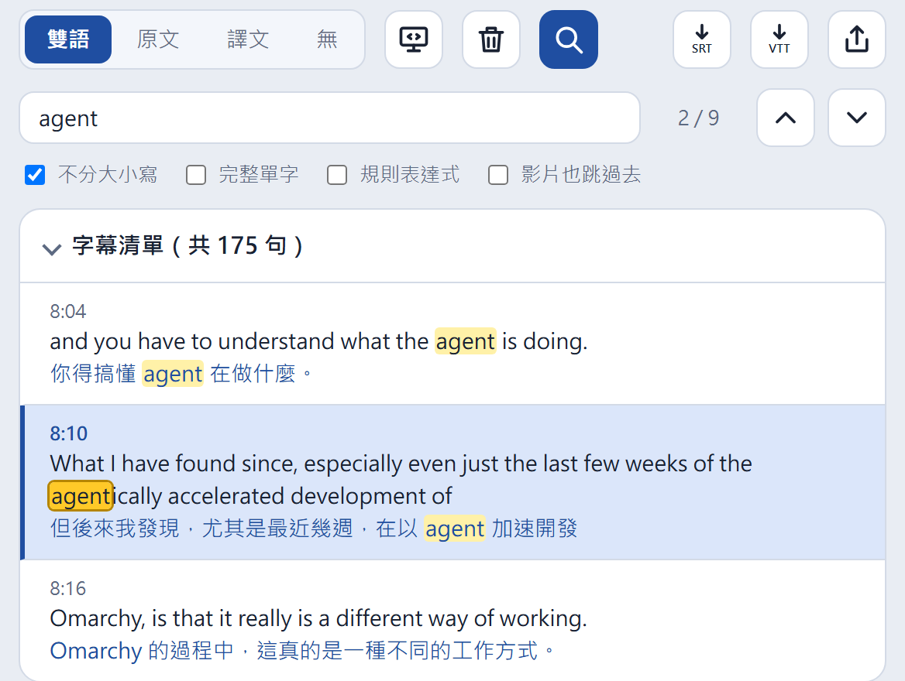

[English](https://github.com/codemee/tubetran/blob/main/README.en.md) | **繁體中文**

# 水管譯工 (TubeTran)

貼上 YouTube 網址即可播放影片，並顯示「原文＋繁體中文」雙語字幕。
同一個程式有兩種執行方式：**桌面應用程式**（直接執行）與**伺服器**（加上 `--server`）。

## 功能

- 優先下載 YouTube 字幕（影片語言的人工字幕優先，其次自動字幕；他語的翻譯字幕不採用）；沒有字幕時，下載音檔並用本機 Whisper 辨識。
- 以 Claude API 翻譯成繁體中文（台灣用語），影片標題也一併翻譯。字幕以「一句一則」呈現：自動字幕原本斷在句子中間的片段，會先重組成完整的句子再翻譯，譯文不會錯位；整支影片的術語（例如 namespace、cgroup）前後譯法一致。
- 字幕疊在影片上，全螢幕時也看得到；太長的字幕會自動折成長度接近的兩行，盡量斷在標點之後。可切換雙語／原文／譯文／無（不顯示字幕，練聽力用），並下載 SRT／VTT。YouTube 原本的字幕一律隱藏，由我們的字幕取代。
- 播放器下方的工具列（圖示按鈕，滑鼠移上去會顯示名稱）：

  

  | 圖示 | 作用 |
  |---|---|
  | 雙語／原文／譯文／無 | 字幕顯示模式；「無」是不顯示字幕，練聽力用 |
  | 簡報板 | 投影片模式（見下一項）；啟用時圖示變成主色 |
  | 垃圾桶 | 刪除這支影片的投影片畫面（省空間）；有擷取好的畫面時才出現 |
  | 放大鏡 | 搜尋字幕（見下方「搜尋字幕」）；展開時圖示變成主色 |
  | 書籤 | 列出這支影片的書籤，點一個跳到對應的字幕（見下方「書籤」）；這支影片有書籤時才出現 |
  | 下載 SRT／VTT | 下載字幕檔（依目前的字幕模式；「無」時下載雙語） |
  | 匯出箭頭 | 匯出這支影片，帶到其他電腦匯入（翻譯完成後出現） |
- 投影片模式（工具列的簡報板圖示）：影片停在某則字幕的時間點，用播放區左右的 ‹ › 按鈕（或 ← →、PageUp／PageDown，簡報遙控器也可以）逐則切換，左上角顯示「第幾則／共幾則」；切換時靜音。再按一次即退出，停在原來的位置。
  - 畫面是自己擷取的，沒有 YouTube 的播放鈕、標題列等介面：第一次進入某支影片的投影片模式時，會在背景下載影片（只要影像，1080p 優先），在每則字幕結束前擷取一張圖（避開句子開始時的轉場，畫面最完整），再刪掉影片。右上角會顯示進度；10 分鐘的影片約 30～40 秒、圖片約 20 MB。
  - 擷取是依字幕順序進行的，已經好的先顯示；還沒好的那幾則暫時看得到 YouTube 的介面。之後再進入投影片模式就直接使用，切換是即時的。
  - 重新處理影片（句子會變）後會重新擷取；匯出檔不含這些圖片，在另一台電腦第一次進入投影片模式時會重新擷取。
  - 不需要時可按工具列的垃圾桶圖示刪除（確認視窗會顯示佔用多少空間），下次進入投影片模式會重新擷取。
- 字幕清單（播放器下方，可展開）跟著播放位置：正在播放的那句會標示出來並自動捲到中間，點任一句可跳到該處播放。自己捲動瀏覽時會暫停跟隨，按右下角的「回到目前字幕」即可回到正在播放的位置。
- 搜尋字幕（工具列的放大鏡）：在字幕清單中找字詞，命中的地方反白（目前這個顏色較深、有外框），清單捲到那一行。

  

  | 操作 | 作用 |
  |---|---|
  | 輸入字詞 | 停止打字後自動搜尋，跳到目前播放位置之後的第一個命中（只捲清單，影片不動）；右邊顯示「第幾個／共幾個」 |
  | ⌃ ⌄ 或 Shift+Enter／Enter | 上一個／下一個命中，到頭會循環 |
  | 不分大小寫 | 預設勾選 |
  | 完整單字 | 只找完整的英文單字（`cat` 不會找到 `catalog`）；中文沒有空格分詞，不受影響 |
  | 規則表達式 | 用規則表達式搜尋（例如 `v\d+`）；寫錯時輸入框變紅 |
  | 影片也跳過去 | 勾選時，按上一個／下一個會讓影片跳到那一則（投影片模式則換到那一張）；不勾只捲清單，可按「回到目前字幕」回去 |
  | Esc／再按一次放大鏡 | 關閉搜尋、清掉反白 |

  - 只搜尋清單上看得到的文字：雙語模式搜原文與譯文，原文／譯文模式只搜那一種。
  - 選項會記在這台電腦上；換影片時搜尋字串保留。
- 書籤：替重要的字幕做記號，之後一鍵跳回去。

  | 操作 | 作用 |
  |---|---|
  | 滑鼠移到字幕清單的某一行 | 該行左側浮現空心的書籤圖示（和工具列的書籤鈕同一個圖示；觸控裝置一律淡淡地顯示） |
  | 按書籤圖示 | 該行展開名稱輸入框；輸入名稱後按 Enter 或 ✓ 加入書籤，Esc 或 ✕ 取消（沒有填名稱就不會加入） |
  | 已有書籤的那一行 | 左側固定顯示實心的書籤圖示，時間旁邊顯示書籤名稱；按圖示可改名，或按「刪除書籤」 |
  | 工具列的書籤鈕（搜尋鈕旁） | 這支影片有書籤時才出現；按一下列出全部書籤（依時間排序），點一個就讓影片跳到那一則字幕（投影片模式則換到那一張），清單也捲到那一行；Esc 或點別處收起；滑鼠移到項目上，右側浮現 ✕，按下即刪除該書籤（清單維持展開；最後一個刪掉後書籤鈕就消失） |

  - 書籤跟著影片存在本機的快取資料夾，不同影片各自獨立；匯出／匯入影片時會一起帶走，刪除影片時一併清除。
  - 書籤以字幕的時間定位：重新處理影片後句子可能重組，書籤會對到時間最接近的那一句。
  - 名稱最長 40 字，每一則字幕最多一個書籤，每支影片最多 200 個。
- 全螢幕：按播放器右下角（YouTube 字樣旁）的全螢幕鈕，或按 `F`。按了全螢幕鈕之後焦點會回到播放器，可以直接用 ← → 倒轉、快轉（投影片模式則是上一則、下一則）。桌面版點過影片之後按 `F` 也有效（瀏覽器模式要先點一下影片外面，才收得到 `F`）。全螢幕鈕會跟著 YouTube 的控制列一起顯示與隱藏：桌面版直接偵測控制列右下角的「YouTube」字樣在不在；瀏覽器模式偵測不到，滑鼠在播放區內就一直顯示。
- 翻譯到一半就能先使用已翻好的部分，其餘在背景繼續；處理進度以明顯的進度條呈現。無字幕的影片會在進度條下方列出語音辨識的各個階段（下載音檔、下載語音辨識模型〔只有第一次〕、載入模型、解碼音檔與偵測語言、辨識語音），完成的打勾、進行中的標示百分比。
- 右側影片庫：列出已翻譯、翻譯中、中斷、失敗的影片，點擊即可重看（中斷或失敗的影片點擊或按 ↻ 重試，從中斷處接著翻），可刪除快取（處理中的影片按 ✕ 會取消處理並清除）；記錄上次播放位置，下次接著看。每個項目與播放器標題下方都有「在 YouTube 開啟」連結，方便回到 YouTube 看留言、相關影片（桌面版會用系統預設瀏覽器開啟）。
- 影片庫的搜尋與標籤：可搜尋標題（原文與譯名）與標籤；每支影片可加標籤（項目上的「＋ 標籤」，按 Enter 新增），清單上方的標籤列點一下即可篩選，可複選（需同時符合），並可與搜尋一起使用。標籤列最前面固定有「無標籤」，點了只列出還沒加標籤的影片（和一般標籤互斥）；標籤很多時只顯示一行，最後面的「更多 +N」可展開全部，「清除篩選」固定在右側。
- 影片庫項目上的按鈕（滑鼠移到項目上才出現）：

  | 按鈕 | 作用 |
  |---|---|
  | ↗ 在 YouTube 開啟 | 回到 YouTube 看留言、相關影片 |
  | ↻ 重新處理 | 丟掉目前的翻譯，重新取得字幕並以整句重新翻譯（會再呼叫 Claude）；觀看進度與標籤保留。舊版翻譯的影片可以用它改成一句一則 |
  | ☑ 檢查字幕 | 合併重複、修正時序、補翻空白譯文（翻譯完成後也會自動跑一次） |
  | ✕ 刪除 | 刪除快取；處理中的影片則是取消處理並清除 |
- 淺色／深色主題，以及繁體中文／English 介面。兩者都是三態按鈕：自動（跟隨系統，預設）→ 手動切換。

## 運作流程

1. 用 `yt-dlp` 取得字幕（影片語言的人工字幕優先，其次自動字幕）。
2. 若沒有字幕：下載音檔 → 本機 `faster-whisper` 語音辨識。
   （Claude API 不接受音檔輸入，因此語音轉文字由 Whisper 負責，Claude 只負責翻譯。）
3. 把斷在句子中間的字幕片段重組成完整的句子（太長的句子在逗號處切開）。
4. 讀完整支影片整理術語表，決定專有名詞的統一譯法。
5. 以 Claude API 分批翻譯成繁體中文；每批都附上術語表與前後幾句當參考，句數不對齊或譯文空白時自動重試。每批翻完就存檢查點，中斷後可從上次的位置接著翻。
6. 翻譯完成後自動檢查字幕，再存入快取。

```
字幕片段（自動字幕依說話節奏斷行）            一句一則（翻譯與顯示的單位）
  8:54  carefully sharing a folder across mount    8:52  When Docker says volume mount, that is carefully
  8:56  views. When Docker says memory limit,  ──▶        sharing a folder across mount views.
  8:58  that is a Cgroup. When a container has     8:57  When Docker says memory limit, that is a Cgroup.
```

結果快取在資料資料夾的 `cache/<video_id>/`，同一支影片不會重複下載或重複付費。

## 兩種模式

| | 桌面模式（預設） | 伺服器模式（`--server`） |
| --- | --- | --- |
| 啟動 | `python -m tubetran` 或 `TubeTran.exe` | `python -m tubetran --server` 或 `TubeTran.exe --server` |
| 介面 | 獨立的無框視窗（Windows 用系統的 WebView2，macOS 用系統的 WKWebView，Linux 用 Qt／GTK）；Windows 與 Linux 上沒有系統標題列，視窗按鈕畫在頁首右上角（見下方說明） | 沒有視窗，用瀏覽器開 http://127.0.0.1:8000/ |
| 埠號 | 固定 `47321`（被占用時改用隨機埠），只接受本機連線 | 預設 `8000`，可用 `--host`、`--port` 修改 |
| 額外需求 | `desktop` 額外套件（pywebview）；Windows 需有 WebView2 | 無 |
| 結束 | 關閉視窗 | `Ctrl+C` |

**桌面模式的視窗（Windows）：** 沒有系統標題列與邊框，頁首右上角有自製的最小化、最大化／還原、關閉按鈕。拖曳頁首空白處或左上角圖示可以移動視窗，雙擊則最大化／還原（最大化時鋪滿螢幕工作區，不會蓋住工作列），視窗四邊與四角可以拖曳縮放。不想要這個外觀的話，加上 `--native-titlebar` 就會改用系統標題列。Linux 也是同樣的無框外觀（用 pywebview 的視窗 API 實作，尚在試用階段：拖曳頁首移動視窗時交給系統（X11、Wayland 都可以），遇到問題請加 `--native-titlebar`）；macOS 一律使用系統標題列。macOS 上全螢幕是讓播放區鋪滿視窗並讓整個視窗進入全螢幕；全螢幕鈕只能靠游標位置估計，滑鼠停止約 4 秒後隱藏，不像 Windows 能直接偵測 YouTube 控制列；桌面版點過影片後的 `F` 快捷鍵也只有 Windows 支援（macOS 請先點一下影片外面，或直接按全螢幕鈕）。

兩種模式共用同一份後端與前端。桌面模式的後端是同一個程序裡的背景執行緒，視窗關閉、程序結束，不會留下孤兒程序。

> **警告：** 伺服器模式沒有任何身分驗證。若用 `--host 0.0.0.0` 讓區網連線，同一網路的任何人都能使用你的 Claude API key 進行翻譯。請只在可信任的網路使用。

## 安裝與執行

需要 [uv](https://docs.astral.sh/uv/)。Python 版本限定 3.12–3.13（較新的版本可能缺少部分依賴的預編譯套件）。主要在 Windows 11 上開發與測試；macOS 也可以執行（Apple 晶片可下載預先打包的 App，或從原始碼、`uv tool install` 執行）。

### 下載 Windows 執行檔（最簡單）

到 [Releases](https://github.com/codemee/tubetran/releases) 下載 `TubeTran-vX.Y.Z-windows-x64.zip`，解壓縮後執行 `TubeTran.exe`（桌面模式；加上 `--server` 則是伺服器模式）。不需要安裝 Python。第一次執行時，在右上角的設定面板輸入 Claude API 金鑰即可。

> 執行檔沒有數位簽章，Windows SmartScreen 可能會警告；選「其他資訊 → 仍要執行」。
>
> 如果桌面視窗打不開、出現 `Failed to resolve Python.Runtime.Loader.Initialize` 之類的錯誤（0.1.1 以前的版本會遇到），是因為 Windows 把從網路下載的檔案標記成「已封鎖」。請對 ZIP 檔按右鍵 →「內容」→ 勾選「解除封鎖」，再重新解壓縮；或在 PowerShell 執行 `Get-ChildItem "TubeTran 資料夾" -Recurse | Unblock-File`。新版程式啟動時會自動清除這個標記。每個版本的 ZIP 由 GitHub Actions 自動建置，內容與 PyPI 上同一版本相同。

### 下載 macOS App（Apple 晶片）

到 [Releases](https://github.com/codemee/tubetran/releases) 下載 `TubeTran-vX.Y.Z-macos-arm64.dmg`，開啟後把 TubeTran 拖進「應用程式」。只提供 Apple 晶片（M 系列）版，沒有 Intel 版。

> App 沒有簽章也沒有公證，第一次開啟時 macOS 會擋下。請在「應用程式」裡對 TubeTran 按右鍵 →「打開」，或到「系統設定 → 隱私權與安全性」按「仍要打開」；也可以執行 `xattr -dr com.apple.quarantine /Applications/TubeTran.app`。

### 用 `uv tool install` 從 PyPI 安裝

```powershell
uv tool install --python 3.12 "tubetran[desktop]"   # 只用伺服器模式的話可省略 [desktop]

tubetran --help                      # 查看所有參數
tubetran --server                    # 伺服器模式：http://127.0.0.1:8000/
tubetran                             # 桌面模式（需要 [desktop]）
```

> **一定要加 `--python 3.12`（或 `3.13`）。** `uv tool install` 預設使用電腦上找到的 Python；如果那是比較新的版本（例如 3.14 以上），語音辨識需要的 `onnxruntime` 還沒有對應的套件，會安裝失敗（`No solution found … onnxruntime … no wheels with a matching Python ABI tag`）。加上參數後，uv 會自動下載需要的 Python。

從原始碼或 GitHub 安裝：

```powershell
uv tool install --python 3.12 ".[desktop]"           # 在專案資料夾執行
uv tool install --python 3.12 "tubetran[desktop] @ git+https://github.com/codemee/tubetran.git"
```

第一次執行時，在網頁右上角的[設定面板](#設定面板)輸入 Claude API 金鑰即可（沒有金鑰時會自動展開）；也可以改設同名的環境變數 `ANTHROPIC_API_KEY`。更新用 `uv tool upgrade tubetran`（從本機資料夾安裝的話，改完程式後用 `uv tool install --python 3.12 --reinstall ".[desktop]"`），移除用 `uv tool uninstall tubetran`。

### Linux 桌面模式

| 做法 | 指令 |
|---|---|
| 建議：Qt 後端（不需系統套件） | `uv tool install --python 3.12 "tubetran[desktop-qt]"`；從原始碼則 `uv sync --extra desktop-qt` 後 `uv run tubetran` |
| GTK 後端 | 先裝系統套件（Debian／Ubuntu：`sudo apt install libgirepository1.0-dev libcairo2-dev pkg-config python3-dev gir1.2-webkit2-4.1`），再 `uv pip install pygobject` |
| 不開視窗 | `tubetran --server`，用瀏覽器開 http://127.0.0.1:8000/ |

- 出現 `[pywebview] GTK cannot be loaded`：沒有 GTK 或 Qt 後端，改用上面的 `desktop-qt`。
- Qt 視窗開不起來：依錯誤訊息補裝系統的 xcb 函式庫（例如 `libxcb-cursor0`）。

### 從原始碼執行（開發用）

```powershell
uv sync --extra desktop              # 桌面模式需要；只用伺服器模式的話只需 uv sync

# 啟動後在網頁的設定面板輸入 API 金鑰；也可以改用環境變數 ANTHROPIC_API_KEY

uv run python -m tubetran                 # 桌面模式
uv run python -m tubetran --server        # 伺服器模式：http://127.0.0.1:8000/
uv run python -m tubetran --server --host 0.0.0.0 --port 9000   # 讓區網連線（請先閱讀上方警告）
uv run python -m tubetran --help          # 查看所有參數
```

不需要預先安裝 `ffmpeg`（語音辨識使用 PyAV 內建的解碼程式庫）；若 `yt-dlp` 對特定影片提示需要它，再安裝即可（`scoop install ffmpeg`）。

## 設定

### 設定面板

頁首右上角、語言鈕左邊的設定鈕會展開設定面板，可以調整：

- **Claude API 金鑰：** 只顯示頭尾各兩碼，中間以 `*` 取代；完整金鑰不會回傳到瀏覽器。要更換就直接貼上新的金鑰。沒有金鑰時程式照常啟動，並自動展開面板請你輸入。
- **翻譯模型：** 選項是向 Anthropic 查詢「這把金鑰實際可用」的模型清單（需要有效金鑰）。
- **語音辨識（STT）模型：** 選項是 faster-whisper 官方支援的模型清單（取自它的 `available_models()`），只在影片沒有字幕時使用。

面板最下方顯示程式版本（例如 `TubeTran v0.1.9`），點一下可前往 GitHub 的發行版本；命令列也可用 `tubetran --version` 查詢。

按「儲存」後寫入資料資料夾的 `settings.json`，對之後開始的任務立即生效，不必重啟。

> **金鑰是以明文存放的。** `settings.json` 內含你的 API 金鑰，沒有加密，也沒有使用系統的憑證儲存區；在 macOS／Linux 上檔案權限會限定只有本人可讀寫。請不要把資料資料夾分享或上傳到任何地方。從原始碼執行時資料資料夾就是專案根目錄，`settings.json` 已被 `.gitignore` 排除。

> **優先順序（高 → 低）：** ① 作業系統的環境變數 ② 設定面板儲存的 `settings.json` ③ 舊式的 `.env`（只讀，程式不再寫入；為了相容舊版而保留）④ 內建預設值。如果 `ANTHROPIC_API_KEY`、`TRANSLATE_MODEL` 或 `WHISPER_MODEL` 在啟動前就已經由環境變數指定，面板會把該欄位鎖住並標示來源（在面板改也不會生效）；要改請修改環境變數，或移除它之後再用面板設定。

### 環境變數

下列變數可用環境變數（或舊式 `.env`）設定；金鑰與兩個模型平常直接用設定面板即可。

| 變數 | 說明 | 預設 |
| --- | --- | --- |
| `ANTHROPIC_API_KEY` | Claude API key（必填） | — |
| `TRANSLATE_MODEL` | 翻譯用模型 | `claude-haiku-5-5` |
| `WHISPER_MODEL` | faster-whisper 模型大小 | `small` |
| `TRANSLATE_BATCH_SIZE` | 每批翻譯句數 | `50` |

有 CUDA 時 faster-whisper 會自動使用 GPU；首次使用會下載模型，大小依模型而定（從數十 MB 到數 GB）。

### 資料資料夾

`settings.json`、快取與桌面版的設定都放在「資料資料夾」，位置依序為：

1. 環境變數 `TUBETRAN_DATA_DIR`（若有設定）
2. 開發時（直接從原始碼資料夾執行）：專案根目錄
3. 其他情況（`uv tool install` 安裝、打包後的程式）：使用者資料目錄 — Windows 是 `%LOCALAPPDATA%\TubeTran`，macOS 是 `~/Library/Application Support/TubeTran`，Linux 是 `$XDG_DATA_HOME/TubeTran`（未設定時為 `~/.local/share/TubeTran`）

資料夾內容：

| 項目 | 說明 |
| --- | --- |
| `settings.json` | 設定面板儲存的設定：API 金鑰（明文）、翻譯模型、STT 模型 |
| `.env` | （選用，舊式）只讀；有的話作為最低優先順序的設定來源 |
| `cache/<video_id>/` | 每支影片的快取：`subs.json`（字幕：原始片段與重組後的整句）、`glossary.json`（術語表）、`translated.json`（最終結果）、`trans_partial.json`（翻譯檢查點，完成後刪除）、`progress.json`（播放位置）、`tags.json`（標籤，最多 10 個、每個 20 字）、`audio.*`（無字幕時的音檔）、`translated.pre-check.json`（手動檢查前的備份）、`slides/`（投影片模式的畫面：每則字幕一張 JPEG） |
| `webview/` | 桌面版的瀏覽器資料（主題與語言設定、cookie），已被 `.gitignore` 排除 |
| `tubetran.log` | 沒有主控台時（例如雙擊啟動）的輸出記錄 |

在影片庫按 ✕ 會刪除該影片整個 `cache/<video_id>/` 資料夾。影片還在處理中時，按 ✕ 會先要求背景任務取消（約在目前這一步，例如一批翻譯完成後結束），任務結束時自己清除快取，卡片會顯示「取消中…」後消失；已呼叫 Claude 翻譯的部分無法退費。

### 把翻好的影片搬到其他電腦

**用匯出／匯入（建議）：** 影片庫上方，搜尋框右邊是「匯入」（箭頭往下進盒子）與「匯出全部」（箭頭往上離開盒子）兩個圖示；滑鼠移上去會顯示名稱。


1. 在原本的電腦匯出，打包成一個 `.json` 檔（桌面版會跳出「另存新檔」讓你選位置）：

   | 圖示 | 位置 | 匯出哪些 | 檔名 |
   |---|---|---|---|
   | 匯出 | 播放器下方的工具列（翻譯完成後出現） | 目前播放的這支影片 | `<影片譯名>.json`（超過 40 字只留前 40 字） |
   | 匯出全部 | 影片庫上方 | 所有已翻譯完成的影片 | `tubetran-<日期>-<支數>.json` |

2. 把檔案帶到另一台電腦，按影片庫上方的「匯入」圖示選擇它（可一次選多個檔案）。影片就會出現在影片庫，播放位置與標籤也一起帶過去。
3. 另一台電腦已經有的影片會略過、不覆蓋。匯出檔包含翻譯、字幕、術語表、播放位置與標籤，不含音檔；觀看不需要 API 金鑰。

**或直接複製資料夾：** 每支影片的所有資料都在自己的 `cache/<video_id>/` 資料夾裡（`video_id` 是網址 `v=` 後面那 11 個字元），整個資料夾複製過去即可：

1. 在原本的電腦找到 `資料資料夾\cache\<video_id>`（例如 `%LOCALAPPDATA%\TubeTran\cache\gKDnMEsYOWs`）。
2. 複製到另一台電腦的 `資料資料夾\cache\` 底下（沒有 `cache` 就自己建立；兩台電腦的作業系統不同也可以）。
3. 開啟水管譯工，影片就會出現在右側影片庫（播放位置與標籤也一起帶過去）。

| 檔案 | 必要？ | 說明 |
| --- | --- | --- |
| `translated.json` | **必要** | 翻好的字幕與標題 |
| `subs.json`、`glossary.json` | 建議 | 之後要按 ↻ 重新處理時用；無字幕影片少了 `subs.json` 就得重新下載音檔、重新辨識 |
| `progress.json`、`tags.json` | 選用 | 播放位置、標籤 |
| `audio.*` | 不必 | 無字幕影片的音檔（可能數十 MB），辨識完就用不到了 |

## 打包（Windows）

```powershell
uv sync --extra desktop
uv run pyinstaller packaging/TubeTran.spec --noconfirm --clean --distpath packaging/dist --workpath packaging/build
```

成品在 `packaging/dist/TubeTran/TubeTran.exe`（資料夾版，需整個資料夾一起散布）。含本機 Whisper 的實測大小：資料夾約 266 MB，壓縮後約 109 MB，其中語音辨識相關的程式庫佔約 80%。`TubeTran.exe --selftest` 可檢查各依賴是否都被正確打包。

打包後的程式：直接執行是桌面模式，`--server` 為伺服器模式；從終端機執行時，輸出會顯示在該終端機。

### 打包（macOS）

同一份 spec 在 macOS 上會多產生一個 App：

```bash
uv sync --extra desktop
uv run pyinstaller packaging/TubeTran.spec --noconfirm --clean --distpath packaging/dist --workpath packaging/build
```

成品是 `packaging/dist/TubeTran.app`（約 200 MB），圖示是 `packaging/TubeTran.icns`。`TubeTran.app/Contents/MacOS/TubeTran --selftest` 可檢查依賴是否都被正確打包。要做成 DMG：把 App 與指向 `/Applications` 的捷徑放進同一個資料夾，再用 `hdiutil create -volname TubeTran -srcfolder <資料夾> -format UDZO TubeTran.dmg`（CI 的做法見 `release.yml` 的 `dmg` 工作）。

## 專案結構

```
tubetran/
  cli.py            命令列入口：桌面模式／--server
  winctl.py         桌面模式（Windows）無框視窗的最大化與邊緣縮放
  config.py         設定與資料資料夾
  settings.py       設定面板的儲存、金鑰遮罩、模型清單
  main.py           FastAPI 路由與靜態檔
  jobs.py           背景任務、快取、影片庫、播放進度
  services/         subtitles（字幕）、sentences（片段重組成整句）、ytdl（yt-dlp 共用設定與下載）、frames（投影片畫面）、transcribe（Whisper）、translate（翻譯、術語表）、review（檢查）、export（SRT/VTT）
  static/           前端（無建置步驟）：index.html、app.js、settings.js、desktop.js、i18n.js、linebreak.js（字幕折行）、style.css、logo/
packaging/          PyInstaller 設定與啟動入口（launch.py）
tests/              pytest
```

## 開發與測試

```powershell
uv run uvicorn tubetran.main:app --reload --reload-dir tubetran   # 開發用：改程式自動重載
uv run pytest
```

在 Windows 上結束 `--reload` 伺服器時，要連同子程序一起結束（`taskkill /PID <pid> /T /F`），否則舊程序可能繼續占用埠號，導致改過的程式沒有生效。

### 發布新版本

發布是全自動的：推送 `v*` 標籤後，[GitHub Actions](https://github.com/codemee/tubetran/blob/main/.github/workflows/release.yml) 會依序執行測試、建置 Python 套件並**發布到 PyPI**、在 Windows 上打包 `TubeTran.exe` 並壓成 **ZIP**、在 macOS（Apple 晶片）上打包 App 並封裝成 **DMG**、建立 GitHub Release 並附上這些檔案。

```powershell
# 1. 修改 pyproject.toml 的 version，更新鎖定檔；寫好這一版的重點 release-notes/v0.2.0.md（中英文），一起提交
uv lock
git add release-notes/v0.2.0.md
git commit -am "版本 0.2.0"
# 2. 打上與版本相同的標籤並推送（標籤必須是 v + pyproject.toml 的版本，否則流程會停下來）
git tag v0.2.0
git push origin main v0.2.0
```

**Release 說明：** 最前面是 `release-notes/<標籤>.md` 的「本版重點」（這一版新增、修正了什麼，使用者看得懂的描述，中英文並列），之後只附 GitHub 自動產生的變更記錄連結；下載與安裝方式寫在 README，不在每個 Release 裡重複。缺少該檔案時，流程會在最前面的測試階段就停下來，不會等到 PyPI 發布後才發現。

**試跑：** 到 GitHub 的 Actions → Release → Run workflow，只會測試與建置，不會發布。

**PyPI 只需要設定一次：** 到 [pypi.org/manage/account/publishing](https://pypi.org/manage/account/publishing/) 新增一個「pending publisher」，填入 PyPI Project name `tubetran`、Owner `codemee`、Repository name `tubetran`、Workflow name `release.yml`、Environment name `pypi`（受信任的發布者，不需要保存任何金鑰）。或者改在 GitHub 的 Settings → Secrets 設定 `PYPI_API_TOKEN`。PyPI 的版本號發布後就不能重複使用，所以發布前請先用試跑確認。

## 注意事項

- 介面語言只影響畫面文字；字幕與標題一律翻譯成繁體中文。
- 舊版翻譯的影片仍是「一段一則」，可能有譯文錯位；在影片庫按 ↻ 重新處理即可改成一句一則（會重新呼叫 Claude）。
- 無字幕影片要先下載音檔、再用 Whisper 在本機辨識，比有字幕的影片慢很多（17 分鐘的影片，CPU 上約需數分鐘；第一次使用還要下載模型）。
- 翻譯會呼叫 Claude API 並產生費用；快取可避免重複付費，但「重新處理」或刪除快取後再看會重新翻譯。
- 翻譯失敗時，狀態列會顯示原因（例如回覆被截斷、少了幾句、網路或 API 錯誤），下方有「重試」鈕；影片庫的卡片也會標成失敗，滑鼠移上去可看到原因。重試會從中斷處接著翻，已翻好的句子不會重翻（不會重複付費）。
- YouTube 常變動，若下載失敗請更新：`uv lock --upgrade-package yt-dlp && uv sync`。
- 無字幕影片下載音檔時，YouTube 要解一道 JavaScript 驗證：電腦上有 deno、node 或 bun 的話會自動使用（建議安裝 deno：Windows `scoop install deno`、macOS `brew install deno`）。沒有也能用，只是 YouTube 偶爾會回「HTTP Error 403: Forbidden」，程式會自動重試 3 次；仍失敗時稍後再試。有字幕的影片不受影響。
- 僅供個人使用，請遵守 YouTube 服務條款與影片版權。

## 授權

本專案以 [GNU 通用公共授權條款第 3 版或（由你選擇）更新版本（GPL-3.0-or-later）](https://github.com/codemee/tubetran/blob/main/LICENSE)釋出。你可以自由使用、研究、修改與散布，但散布修改版（包含打包成執行檔）時，必須同樣以 GPL 公開原始碼。
