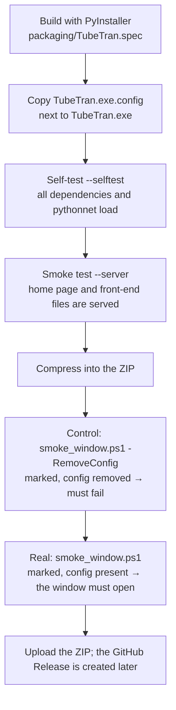

# Windows packaging and the "downloaded ZIP" test

🌐 [繁體中文](https://github.com/codemee/tubetran/blob/main/docs/zh-TW/windows-packaging.md) ｜ English ｜ [Back to the README](https://github.com/codemee/tubetran/blob/main/README.en.md)

This page explains why the Windows ZIP ships a `TubeTran.exe.config`, and how the release flow checks that **a ZIP downloaded from GitHub really opens its window**. The config: [`packaging/TubeTran.exe.config`](https://github.com/codemee/tubetran/blob/main/packaging/TubeTran.exe.config), the test script: [`packaging/smoke_window.ps1`](https://github.com/codemee/tubetran/blob/main/packaging/smoke_window.ps1), the workflow: [`.github/workflows/release.yml`](https://github.com/codemee/tubetran/blob/main/.github/workflows/release.yml).

## The problem

| Item | Details |
|---|---|
| Symptom | Download the ZIP from GitHub, extract it and double-click: an error dialog appears — `Failed to resolve Python.Runtime.Loader.Initialize from …\pythonnet\runtime\Python.Runtime.dll` — and the desktop window never opens |
| Cause | Files extracted from a browser-downloaded ZIP all carry the "downloaded from the Internet" mark (Mark of the Web, NTFS `Zone.Identifier`). The desktop window loads .NET's `Python.Runtime.dll` through pywebview + pythonnet, and .NET Framework refuses to load components carrying that mark by default |
| Why it went unnoticed | Files downloaded with `gh`, extracted with PowerShell, or built inside CI **carry no mark**. You can't see the problem unless you add the mark yourself |
| Affected | Only the Windows ZIP. PyPI installs (`uv tool install`), macOS and browser mode are not affected |

## The fix

Put a `TubeTran.exe.config` **next to** `TubeTran.exe`:

```xml
<configuration>
  <runtime>
    <loadFromRemoteSources enabled="true"/>
  </runtime>
</configuration>
```

- It tells .NET to allow loading these components. They live in the program's own folder (local), not on the network.
- The name must be "executable name + `.config`", in the same folder as `TubeTran.exe` (not inside `_internal`).
- **Users must not copy only `TubeTran.exe` or delete this file**, otherwise marked files fail to load again.

### Why we no longer clear the mark at startup

Since 0.1.2 the program deleted each DLL's `Zone.Identifier` at startup. The config file replaces that:

| | Clear the mark at startup (old) | Config file (now) |
|---|---|---|
| Modifies the user's files | Yes, on every launch | No |
| Read-only folder | Cannot delete, window still fails | Not affected |
| Ordering constraint | Must run before pythonnet is loaded | None |
| Code | A function, tests and a CI control switch to maintain | One static file |

If the window still cannot open, the program shows a dialog explaining how to unblock the files, as a last resort (`_desktop_failure_text` in `cli.py`).

## How the release flow checks it



The key point: the test runs on **the ZIP that will actually be released**, not the build folder.

### What `smoke_window.ps1` does

1. Extracts the ZIP into a temporary folder.
2. **Marks every file** (`Zone.Identifier`, ZoneId=3) to imitate a browser-downloaded ZIP.
3. Starts `TubeTran.exe` directly with CreateProcess (no shell, so the "cannot verify the publisher" dialog doesn't block it). It uses a temporary data folder and leaves the user's (or other CI steps') data alone.
4. Waits for the main window and decides by the **window's Win32 class name**:

| Window class | Meaning |
|---|---|
| `WindowsForms10…` | pywebview's normal window — success |
| `#32770` | A system dialog, i.e. the error window shown when the program cannot open — failure |

5. After success it waits 5 more seconds to be sure no error dialog appears afterwards, then ends the program and deletes the temporary folder.

> Why not the title: the error dialog is titled "水管譯工" too, the same as the window's title in the Chinese UI, so the title alone can't tell them apart.

Exit codes: `0` the window opened, `1` failure.

### The control

`-RemoveConfig` deletes `TubeTran.exe.config` before marking. That case **must fail**; if it succeeds, the test cannot catch the problem (for example the runner's environment makes the mark ineffective), and the flow stops instead of giving false reassurance from a test that always passes.

| Parameter | Purpose |
|---|---|
| `-Zip <path>` | The ZIP to test (required) |
| `-RemoveConfig` | Control: remove the config, expected to fail |
| `-NoMotw` | Control: no mark, to confirm unmarked files open anyway |
| `-TimeoutSeconds <s>` | How long to wait for the window, default 60 |

## Verify locally

```powershell
uv run python -m PyInstaller packaging/TubeTran.spec --noconfirm --clean --distpath packaging/dist --workpath packaging/build
Copy-Item packaging/TubeTran.exe.config packaging/dist/TubeTran/
Compress-Archive -Path packaging/dist/TubeTran -DestinationPath TubeTran-test.zip -CompressionLevel Optimal

pwsh packaging/smoke_window.ps1 -Zip TubeTran-test.zip -RemoveConfig   # control: expect FAIL (exit code 1)
pwsh packaging/smoke_window.ps1 -Zip TubeTran-test.zip                 # expect OK (exit code 0)
```

The test briefly opens windows and closes them when done. `packaging/build/` and `packaging/dist/` are in `.gitignore`.

## Known limitations

- The test needs a Windows session with a desktop (GitHub's `windows-latest` has one).
- It only covers the "ZIP with the Mark of the Web" case; the SmartScreen warning for unsigned executables ("Windows protected your PC") is a separate matter — users must click "More info → Run anyway", which is not handled here.
