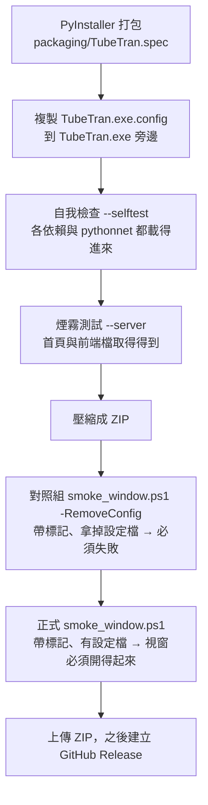

# Windows 打包與「下載情境」測試

🌐 繁體中文 ｜ [English](https://github.com/codemee/tubetran/blob/main/docs/en/windows-packaging.md) ｜ [回到 README](https://github.com/codemee/tubetran/blob/main/README.md)

這份文件說明 Windows 版 ZIP 為什麼要附 `TubeTran.exe.config`，以及發布流程怎麼確認「從 GitHub 下載的 ZIP 真的開得了視窗」。設定檔：[`packaging/TubeTran.exe.config`](https://github.com/codemee/tubetran/blob/main/packaging/TubeTran.exe.config)、測試腳本：[`packaging/smoke_window.ps1`](https://github.com/codemee/tubetran/blob/main/packaging/smoke_window.ps1)、流程：[`.github/workflows/release.yml`](https://github.com/codemee/tubetran/blob/main/.github/workflows/release.yml)。

## 問題

| 項目 | 說明 |
|---|---|
| 症狀 | 從 GitHub 下載 ZIP、解壓縮後雙擊，跳出錯誤對話框：`Failed to resolve Python.Runtime.Loader.Initialize from …\pythonnet\runtime\Python.Runtime.dll`，桌面視窗開不起來 |
| 原因 | 用瀏覽器下載的檔案，解壓縮後每個檔案都帶「來自網際網路」標記（Mark of the Web，NTFS 的 `Zone.Identifier`）。桌面視窗靠 pywebview + pythonnet 載入 .NET 的 `Python.Runtime.dll`，而 .NET Framework 預設拒絕載入帶這個標記的元件 |
| 為什麼開發時沒發現 | 用 `gh` 下載、用 PowerShell 解壓縮、CI 裡直接建置出來的檔案，**都不帶標記**。不自己加上標記就測不到 |
| 影響範圍 | 只有 Windows 的 ZIP 版。PyPI 安裝（`uv tool install`）、macOS、瀏覽器模式都不受影響 |

## 解法

在 `TubeTran.exe` **旁邊**放一個 `TubeTran.exe.config`：

```xml
<configuration>
  <runtime>
    <loadFromRemoteSources enabled="true"/>
  </runtime>
</configuration>
```

- 它告訴 .NET 允許載入這些元件。元件都在程式自己的資料夾裡（本機），不是從網路載入。
- 檔名必須是「執行檔名稱 + `.config`」，並和 `TubeTran.exe` 在同一層（不是 `_internal` 裡面）。
- **使用者不能只複製 `TubeTran.exe` 或刪掉這個檔案**，否則帶標記時又會打不開。

### 為什麼不再於啟動時清除標記

0.1.2 起的做法是程式啟動時逐一刪除每個 DLL 的 `Zone.Identifier`。改成設定檔的原因：

| | 啟動時清除標記（舊） | 設定檔（現在） |
|---|---|---|
| 修改使用者的檔案 | 會，每次啟動都動 | 不會 |
| 唯讀資料夾 | 刪不掉，視窗還是打不開 | 沒影響 |
| 順序限制 | 必須在載入 pythonnet 之前執行 | 無 |
| 程式碼 | 要維護函式、測試與 CI 的對照開關 | 一個靜態檔案 |

打不開視窗時，程式仍會跳出對話框說明如何解除封鎖，當作最後的後備（`cli.py` 的 `_desktop_failure_text`）。

## 發布流程怎麼確認



重點：測試對象是**最後要發布的那個 ZIP**，不是建置資料夾。

### `smoke_window.ps1` 做了什麼

1. 把 ZIP 解壓縮到暫存資料夾。
2. **替每個檔案加上標記**（`Zone.Identifier`，ZoneId=3），模擬瀏覽器下載的 ZIP。
3. 用 CreateProcess 直接啟動 `TubeTran.exe`（不經過 shell，才不會跳出「無法驗證發行者」對話框而卡住）。資料夾用暫存的，不碰使用者或 CI 其他步驟的資料。
4. 等主視窗出現，用**視窗的 Win32 類別名稱**判斷：

| 視窗類別 | 意思 |
|---|---|
| `WindowsForms10…` | pywebview 的正常視窗，成功 |
| `#32770` | 系統對話框，也就是打不開時程式跳出的錯誤視窗，失敗 |

5. 成功後再等 5 秒，確認沒有隨後跳出錯誤對話框，然後結束程式、刪掉暫存資料夾。

> 為什麼不看標題：打不開時的錯誤對話框標題也是「水管譯工」，和中文介面成功時的視窗標題一樣，只看標題分不出來。

結束碼：`0` 視窗正常開啟，`1` 失敗。

### 對照組

`-RemoveConfig` 會在加標記前刪掉 `TubeTran.exe.config`。這種情況**必須失敗**；如果它成功了，代表測試抓不到問題（例如 runner 的環境讓標記失效），流程會直接停下來，不會讓一個永遠通過的測試給出虛假的安心。

| 參數 | 用途 |
|---|---|
| `-Zip <路徑>` | 要測的 ZIP（必填） |
| `-RemoveConfig` | 對照組：刪掉設定檔，預期失敗 |
| `-NoMotw` | 對照組：不加標記，確認不帶標記本來就開得了 |
| `-TimeoutSeconds <秒>` | 等視窗的時間，預設 60 |

## 在本機驗證

```powershell
uv run python -m PyInstaller packaging/TubeTran.spec --noconfirm --clean --distpath packaging/dist --workpath packaging/build
Copy-Item packaging/TubeTran.exe.config packaging/dist/TubeTran/
Compress-Archive -Path packaging/dist/TubeTran -DestinationPath TubeTran-test.zip -CompressionLevel Optimal

pwsh packaging/smoke_window.ps1 -Zip TubeTran-test.zip -RemoveConfig   # 對照組：預期 FAIL（結束碼 1）
pwsh packaging/smoke_window.ps1 -Zip TubeTran-test.zip                 # 預期 OK（結束碼 0）
```

測試會短暫開出視窗，並在結束時關掉。`packaging/build/`、`packaging/dist/` 已在 `.gitignore` 裡。

## 已知限制

- 測試需要有桌面工作階段的 Windows（GitHub 的 `windows-latest` 有）。
- 只涵蓋「帶 Mark of the Web 的 ZIP」這個情境；SmartScreen 對沒有簽章的執行檔的警告（「Windows 已保護您的電腦」）是另一回事，需要使用者按「其他資訊 → 仍要執行」，這裡沒有處理。
